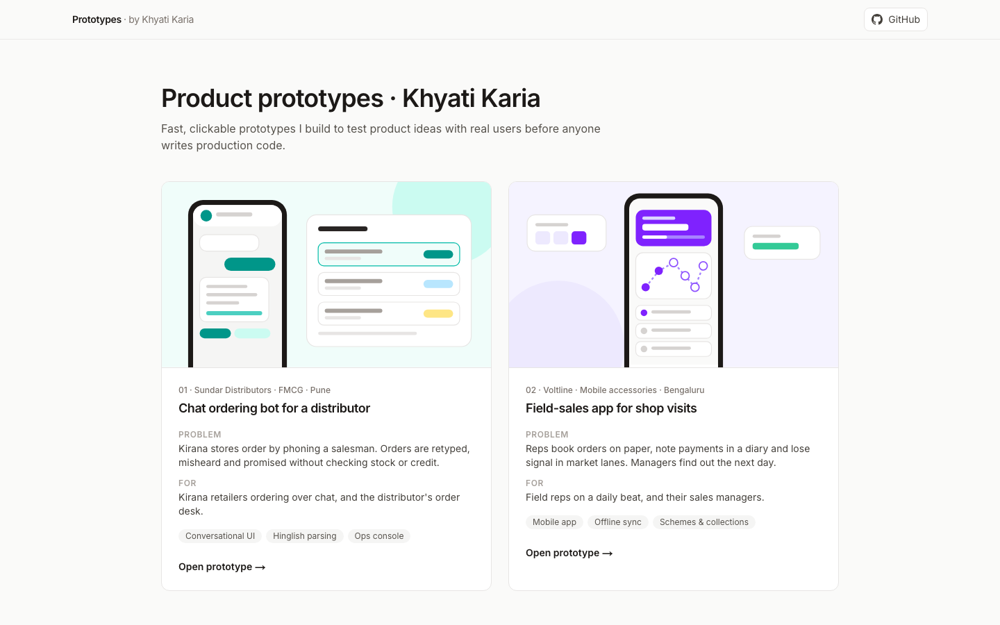
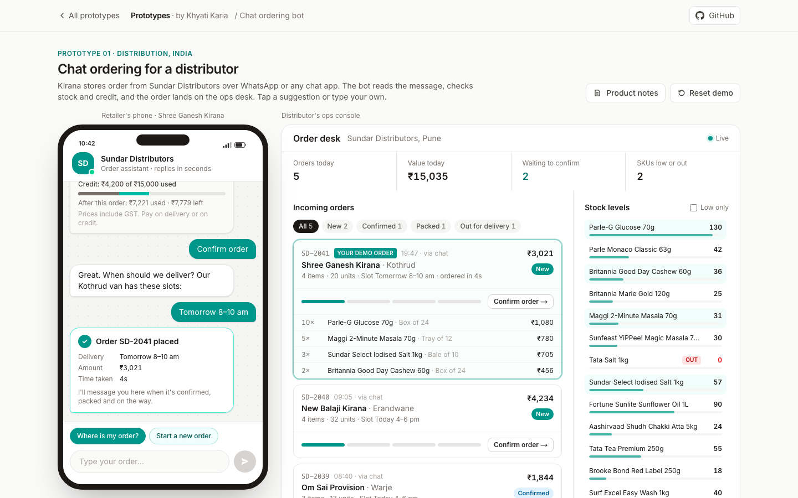
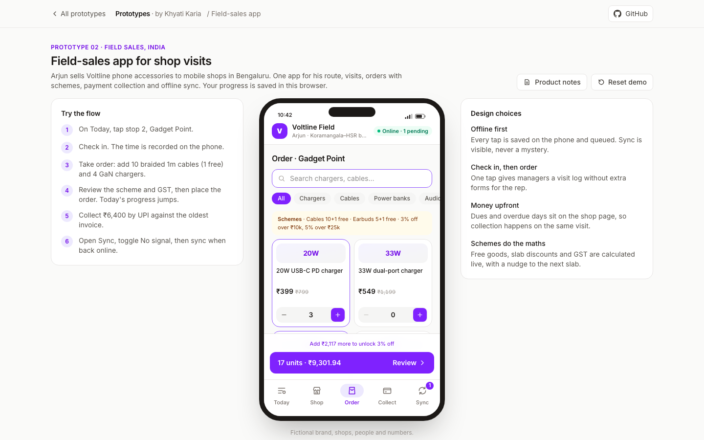

# Product prototypes

Fast, clickable prototypes I build to test product ideas with real users before anyone writes production code. Each one is a front-end-only Next.js app with fictional companies and sample data, but the business rules underneath (order parsing, stock, credit limits, schemes, GST, collections) are real code with unit tests. Every prototype has a **Product notes** drawer that lays out the problem, the assumptions being tested and what I would measure next.



---

## 01 · Chat ordering bot for a distributor

**Open the prototype:** https://khyati-prototypes.vercel.app/order-bot



**Problem.** Sundar Distributors (fictional), an FMCG distributor in Pune, takes orders from ~300 kirana stores through salesmen who phone them in. Orders are retyped, items get misheard, and a shop finds out salt is out of stock only when the van arrives without it.

**Users.** Kirana owners who already order over WhatsApp or another chat app, often in Hinglish; the two-person order desk; the warehouse.

**Key flows**
- Retailer types or taps an order ("Need 10 Parle-G, 5 Maggi 12-pack, 3 Tata Salt", or "10 Maggi bhej do"). The bot matches it against a 21-SKU catalogue with pack sizes, prices and minimum order quantities.
- Out-of-stock items are flagged with a substitute (Tata Salt → the distributor's own brand); quantities below MOQ are raised; misspellings get a "did you mean".
- Order summary with total and a credit-limit check ("₹4,200 of ₹15,000 credit used", and what's left after this order).
- Confirm, pick a delivery slot, and the order appears live in the ops console with the time it took to place.
- The ops desk moves it New → Confirmed → Packed → Out for delivery, and each step is sent back to the retailer in the chat. Stock levels update as orders are reserved.
- Desktop shows the retailer's phone and the ops console side by side; on mobile they are two tabs.

**What I'd measure next**
- Time to place an order (first message to confirmed; target under 2 minutes).
- Order errors: lines changed or returned after confirmation, against salesman-taken orders.
- Repeat rate: retailers placing a second chat order within 14 days.
- Parser fallback rate, which decides whether real NLP is worth building.
- Substitute acceptance rate.

---

## 02 · Field-sales app for shop visits

**Open the prototype:** https://khyati-prototypes.vercel.app/field-sales



**Problem.** Voltline (fictional) sells phone accessories through mobile shops in Bengaluru. Its reps book orders on paper, note payments in a diary and lose signal in basements and market lanes. Managers learn what happened the next morning, and nobody on the road knows which shop is overdue.

**Users.** Field reps like Arjun on a budget Android phone with patchy 4G; area sales managers; accounts.

**Key flows**
- **Today:** a six-shop beat with a route sketch, visit status, and sales achieved against the day's target.
- **Shop:** one-tap check-in with a timestamp, last order, outstanding invoices with an overdue warning, and notes.
- **Take order:** searchable product grid with quantity steppers; free-goods schemes (buy 10 cables, get 1 free), slab discounts (3% over ₹10,000, 5% over ₹25,000), 18% GST, and a nudge showing how much more unlocks the next slab.
- **Collect payment:** UPI, cash or cheque against the outstanding balance, applied oldest invoice first, with validation (6-digit cheque numbers, the ₹2 lakh cash limit) and a receipt.
- **Sync:** an offline badge, a queue of pending check-ins, orders and payments, and "Sync now".
- Placing an order and checking in update Today's progress. State is kept in React context and saved to `localStorage` (wrapped in try/catch), with a Reset button.

**What I'd measure next**
- Orders per visit and average order value against paper orders (does the slab nudge lift value?).
- Time in shop from check-in to order placed (target under 3 minutes).
- Collection efficiency: collected against overdue on the beat, week on week.
- Sync lag from action to office.
- Visit compliance: planned shops actually checked in.

---

## Tech stack

- Next.js 16 (App Router) and React 19, TypeScript in strict mode
- Tailwind CSS v4, Inter via `next/font`
- Vitest for the pure logic in `lib/`
- No backend, no API keys, no tracking. Light and dark themes follow the system setting, and animations respect `prefers-reduced-motion`.

All money is handled as integer paise, so totals, discounts and GST never drift.

## Run locally

```bash
npm install
npm run dev      # http://localhost:3000
npm test         # unit tests for lib/
npm run lint
npm run build
```

## Structure

```
app/
  page.tsx                 Gallery
  order-bot/page.tsx       Prototype 01
  field-sales/page.tsx     Prototype 02
components/
  SiteHeader.tsx, PhoneFrame.tsx, ProductNotes.tsx, Thumbnails.tsx
  order-bot/               Conversation engine (reducer), chat phone, ops console
  field-sales/             Context store with localStorage, the five app screens
lib/
  money.ts                 Paise formatting (Indian digit grouping) and parsing
  sundar-catalog.ts        21-SKU FMCG catalogue and starting stock
  order-parser.ts          Keyword/SKU matcher for English and Hinglish messages
  order-cart.ts            Stock, MOQ, substitutes, totals, credit check
  voltline-data.ts         Products, schemes, slabs, shops and invoices
  field-sales.ts           Order pricing, GST, collection allocation, day progress
  *.test.ts                Vitest tests
docs/                      Screenshots used in this README
```

All companies, people, shops and numbers are invented. Product brand names in the FMCG catalogue are used only as realistic sample data and belong to their owners.
